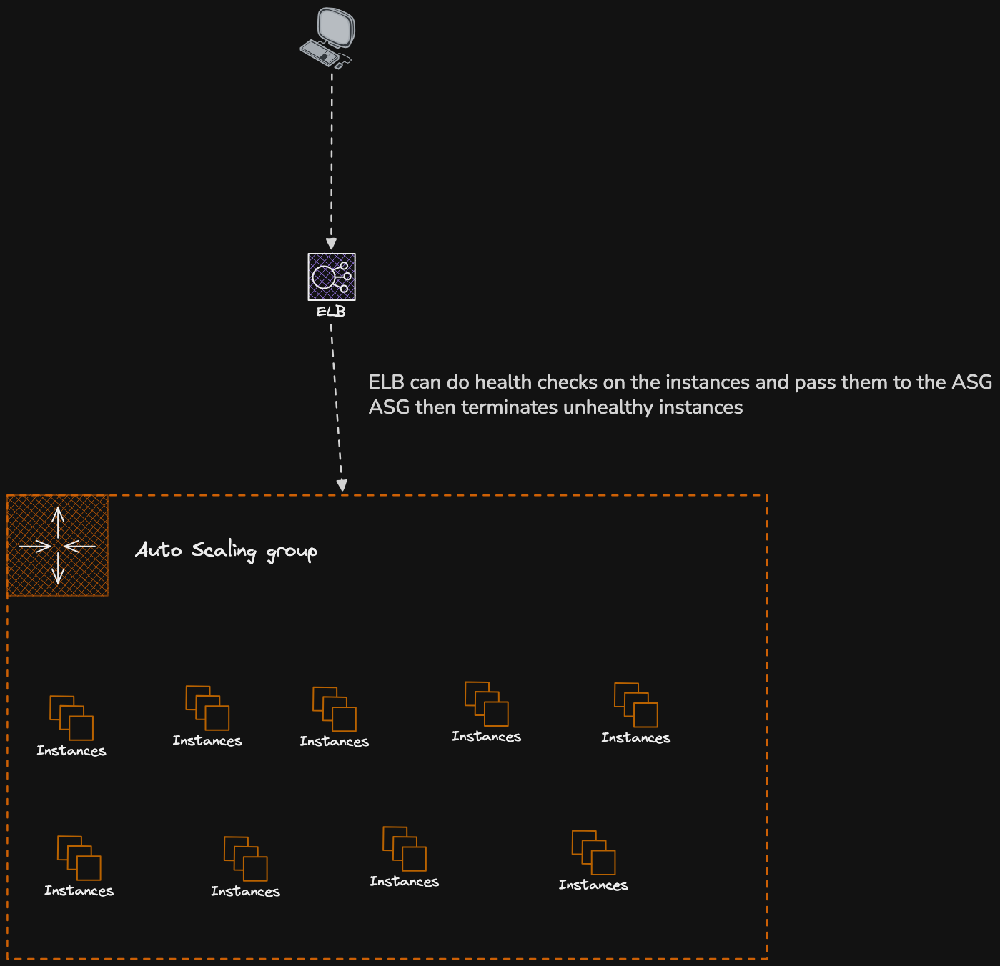

# Auto Scaling Group

## Using netflix as a case study

Traffic follows a daily evening curve, peaking every night between 7:00 PM and 11:00 PM as people finish work or school and start streaming, with extra spikes on weekends or when a blockbuster show drops.

**ASG** can solve this issue by

1. Scaling In(Reduce / Remove Instances) to match decreased load
2. Scaling Out(Increase / Add Instances) to match increased load

### Types of capacity

1. Minimum Capacity - At least this number
2. Desired Capacity - At any given time this is the number I want
3. Maximum Capacity - At most this number

### ASG With Load Balancer

### ASG with CloudWatch

Based on the alarm we can create scale-in and out policies

## Reference

Netflix Cloud Topology - [https://www.youtube.com/watch?v=TkFyZyxFRBM]
