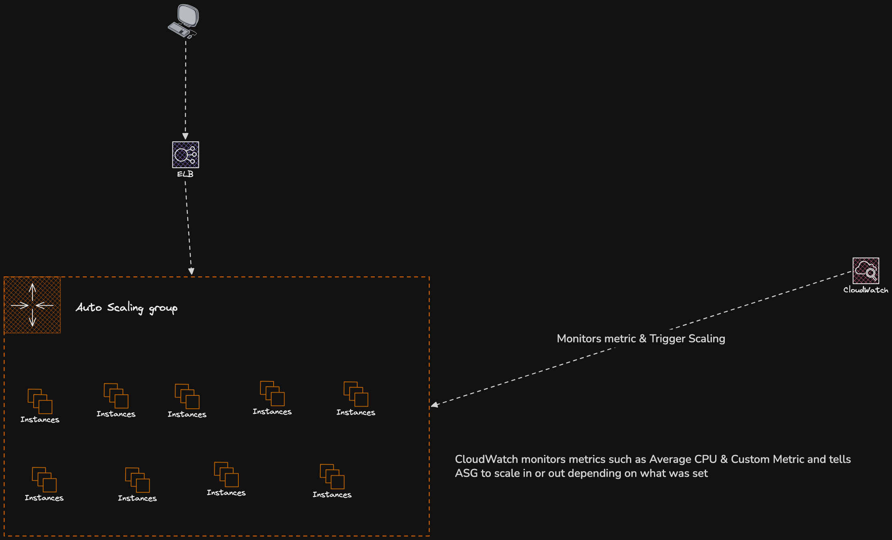

# Auto Scaling Group

## Using netflix as a case study

Traffic follows a daily evening curve, peaking every night between 7:00 PM and 11:00 PM as people finish work or school and start streaming, with extra spikes on weekends or when a blockbuster show drops.

**ASG** can solve this issue by

1. Scaling In(Reduce / Remove Instances) to match decreased load
2. Scaling Out(Increase / Add Instances) to match increased load

### Types of capacity

1. Minimum Capacity - At least this number
2. Desired Capacity - At any given time this is the number I want
3. Maximum Capacity - At most this number

### ASG With Load Balancer

### ASG with CloudWatch

Based on the alarm we can create scale-in and out policies

### ASG Scaling Policies aka Automatic Scaling

1. Dynamic Scaling
    - Target Tracking Scaling : Example of this is - I want my average ASG CPU to stay around 40%
    - Simple or Step Scaling : Example of this is - When a cloudwatch alarm is triggered(CPU > 60%) Scale out to 4

2. Schedule Scaling - Trying to predict or anticipate traffic based on usage patterns. Example - Increase min capacity to 4 at 7pm on Friday evening. a live boxing match or a one-off live show at 9pm Saturday. It’s a known date, so you schedule it.
3. Predictive Scaling - continously forecasting load and scale ahead of time. every day, streaming climbs from about 6pm, peaks around 9pm, and drops off after midnight. It’s the same shape every day, just a little different each time. Predictive scaling learns that curve and adds capacity before 6pm without you writing a schedule.

### Types of metrics to scale on

1. CPU Utilization
2. RequestCountPerTarget
3. In / Out Network
4. Custom Metric

## Reference

Netflix Cloud Topology - [https://www.youtube.com/watch?v=TkFyZyxFRBM]
