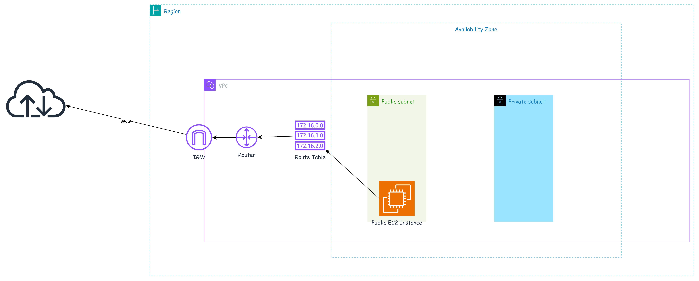

# Internet Gateway

Internet Gateway allows resources to be connected to the internet..

- It scales horizontally and highly available
- only one VPC can be attached to an IGW
- IGW do not allow internet access on thier own, they do that with route tables

