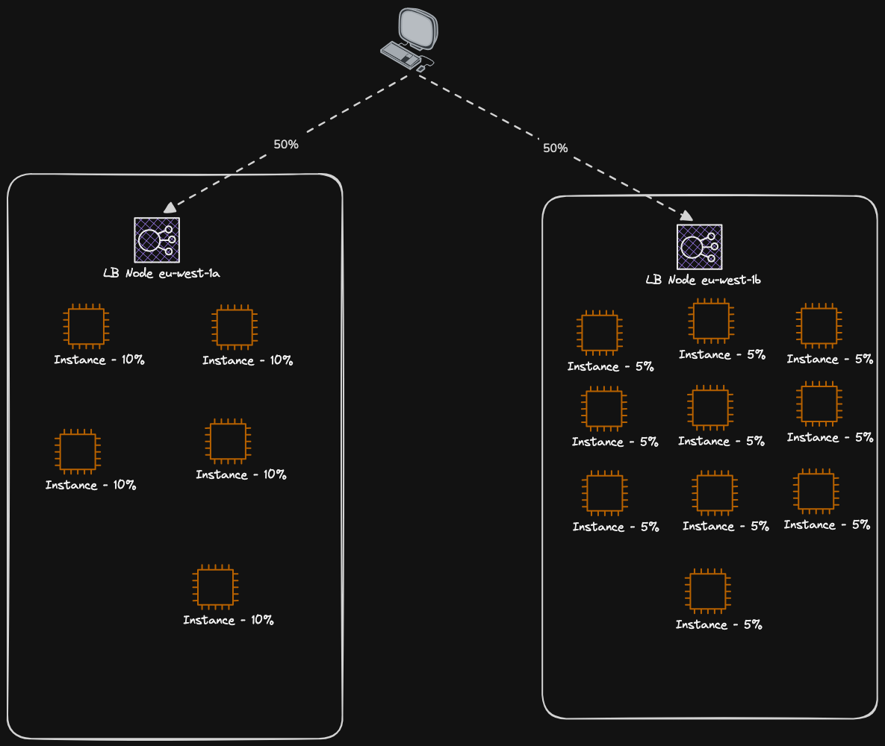
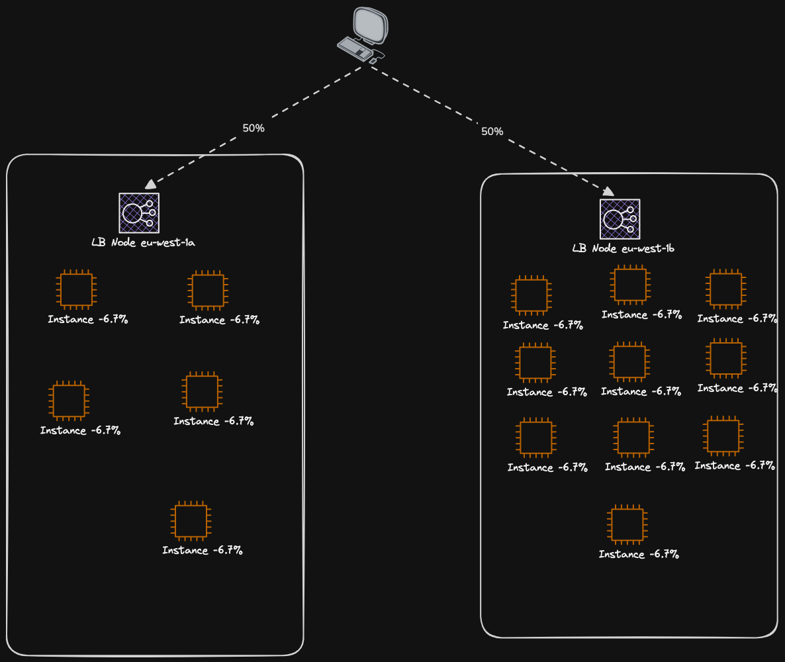
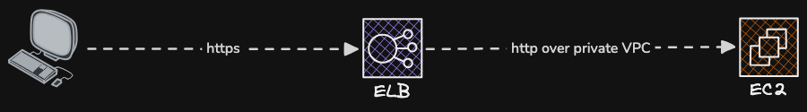

# AWS Networking Services

## Connectivity

- **VPC (subnets)**: your private network in AWS, split into public and private subnets.
- **Internet Gateway**: lets a VPC talk to the internet, in both directions.
- **Egress-only Internet Gateway**: outbound-only internet for IPv6.
- **NAT Gateway**: lets private subnets reach the internet without being reachable from it.
- **Elastic IP / ENI**: a fixed public IP, and the network card attached to a resource.
- **VPC Peering**: a direct 1:1 link between two VPCs. Simple, but doesn't scale.
- **Transit Gateway**: a central hub connecting many VPCs and on-prem networks.
- **AWS Cloud WAN**: a managed global network across regions, run from one policy.
- **Site-to-Site VPN**: an encrypted tunnel from on-prem to AWS over the internet.
- **Client VPN**: lets individual users VPN into AWS.
- **Direct Connect**: a dedicated private line from your data centre to AWS.
- **PrivateLink / VPC Endpoints**: private access to AWS services or other VPCs without touching the internet.
- **VPC Lattice**: service-to-service connectivity across VPCs and accounts, with built-in auth.
- **VPC IPAM**: plans and tracks IP ranges so CIDRs don't clash.

## Network Security

- **Security Groups**: stateful firewall at the instance or ENI level, allow rules only.
- **Network ACLs**: stateless firewall at the subnet level, with allow and deny rules.
- **AWS WAF**: blocks bad HTTP requests (SQLi, XSS, bots) in front of ALB, CloudFront, or API Gateway.
- **AWS Shield**: DDoS protection. Standard is free; Advanced is paid and comes with a response team.
- **AWS Network Firewall**: managed firewall for deep packet inspection and domain filtering at the VPC level.
- **AWS Firewall Manager**: pushes WAF, security group, and firewall rules across all accounts centrally.
- **Route 53 Resolver DNS Firewall**: blocks DNS lookups to bad or unapproved domains.
- **Gateway Load Balancer**: routes traffic through third-party firewall or inspection appliances.
- **AWS Verified Access**: zero-trust access to internal apps without a VPN.
- **VPC Flow Logs**: records which IPs talked to which, and whether traffic was allowed.
- **Reachability / Network Access Analyzer**: checks whether a path is open, and finds paths that shouldn't be.

## Routing & Traffic Management

- **Route Tables**: decide where traffic leaves a subnet: IGW, NAT, TGW, peering, and so on.
- **Route 53**: DNS, plus routing policies like latency, geo, weighted, and failover with health checks.
- **Route 53 Resolver**: DNS between your VPCs and on-prem, in both directions.
- **Application Load Balancer**: Layer 7 load balancing. Routes on path, host, and headers.
- **Network Load Balancer**: Layer 4 load balancing. Very fast, with static IPs.
- **CloudFront**: CDN that caches content close to users.
- **Global Accelerator**: sends users onto AWS's backbone at the nearest edge, with fast regional failover.
- **API Gateway**: front door for APIs, handling routing, throttling, and auth.
- **AWS Cloud Map**: service discovery, so services can find each other by name.

## Services that straddle categories

- **Gateway Load Balancer**: a load balancer by design, but used almost entirely for security inspection.
- **VPC Lattice**: touches connectivity, routing, and security (auth policies).
- **PrivateLink**: connectivity, but chosen mainly for the security benefit of staying off the internet.
- **Flow Logs / Reachability Analyzer**: visibility tools, grouped under security because that's their main use.

### Core Difference Between AWS Load Balancers

1. ALB(Application Load Balancer) - Mainly dealing with HTTP and HTTPS traffic (Web requests) Application Layer on OSI
2. NLB(Network Load Balancer) - Mainly TCP, UDP and TLS traffic(Network Connection) - Transport Layer on OSI
3. GLB(Gateway Load Balancer) - Distributes Traffic to multiple virutal apliances(Firewall,  Intrusion Detection Software) for inspection before traffic continues to destination. GLB provides a centralised point for distributing traffic across multiple appliances

### Best Practices For Network Security

1. If you have an ALB in front of EC2 instances, instances should only accept inbound traffic from the ALB's security group.
   - SGs are stateful: responses back to the ALB are allowed automatically, so no instance egress rule is needed for them.
   - Restrict ALB egress to the instance SG on the app and health check ports.
   - Instance egress should allow only what the instance itself starts (DB, package repos, AWS APIs), not "ALB only".
   - NACLs are stateless: allow ephemeral ports (1024–65535) outbound to the ALB subnets.

### Sticky Sessions In Load Balancer

Sticky Session enables the load balancer to bind a user's session to a specific instance. This ensures that all requests from the user during the session are sent to the same instance.

### Cross Load Balancing

Cross load balancing is evenly distributing traffic across instances in all AZ. But when and why would I consider this approach.

#### Cross-zone load balancing — example

Setup: 1 load balancer, nodes in eu-west-1a and eu-west-1b.
10 instances in 1a, 10 instances in 1b.

5 instances in 1a go down → 5 in 1a, 10 in 1b (15 total).

**Cross-zone OFF:** each node only sends to its own AZ.

Each AZ still gets 50% of traffic.

- 1a: 50% ÷ 5  = 10% per instance (overloaded)
- 1b: 50% ÷ 10 = 5% per instance (underused)

**Cross-zone ON:** nodes send to all healthy targets in any AZ.

- 100% ÷ 15 = ~6.7% per instance, even load

Takeaway: cross-zone evens out load *per instance*, not per AZ.
Matters most when instance counts across AZs are uneven.

### SSL & TLS

1. SSL Ceritificate - Traffic between client and LB is encrypted in trasnit that is called inflight encryption. Traffic can only be decrypted by only the sender and the reciever.

2. SSL - Secure Sockets Layer is used to encrypt connections
3. TLS - Transport Layer Security, A newer version of TLS

### References

1. OSI Model - [https://www.infosectrain.com/blog/osi-model-a-comprehensive-guide-for-exam-and-interview]