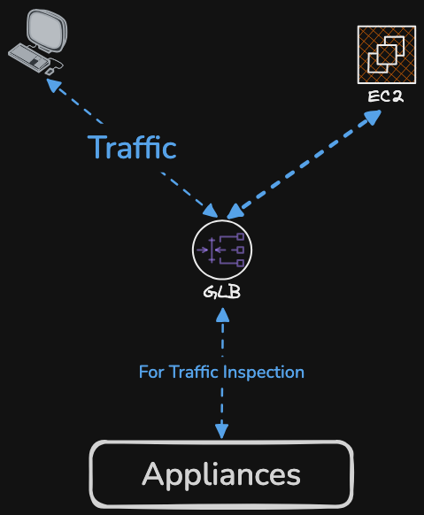

# Gateway Load Balancer

1. Operates at the Network Layer(LAYER 3) on the OSI model
2. Makes use of the geneve protocol on 6081

## Customer Chanllenges Before Gateway Load Balancers

Virual Appliances are virutal network functions( Software applications that provide network capabilities, such as routing, firewalls and load balancers example of this is Nginx) running on ec2s

Customers uses because they like the specilised functions of the appliances. So customers wants to use this on AWS network but they end up getting issues during deployment like Single point of failures, Complexity in managing.

## Solutions

GLB comprises of two entities - A gateway and a Load Balancer. GLB has both layer 3 and Layer 4 characteristics, since it acts as both a gateway and a load balancer.

## Use Cases

1. North/South Inspection (VPC to internet using IGW)
2. North/South Inspection (VPC to internet using TGW)
3. Inter VPC traffic inspection using TGW

### References

1. GLB [https://www.youtube.com/watch?v=-j2smz_VCH4]
