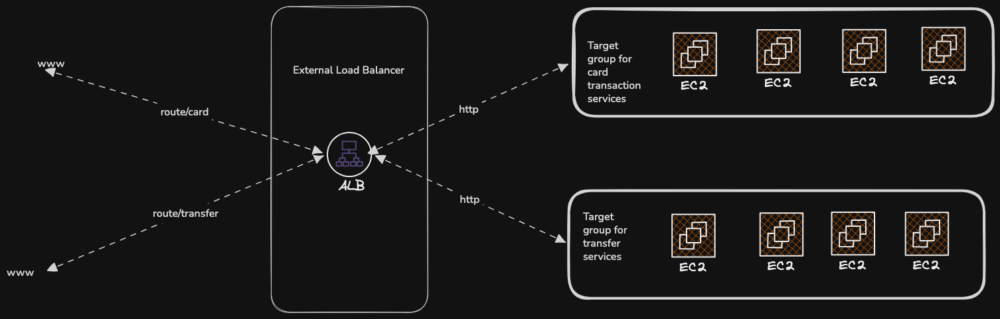
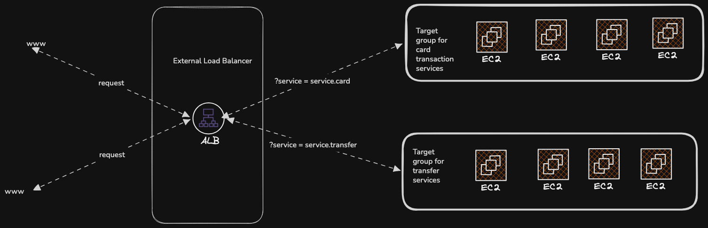

# Application Load Balancer

1. This is a service that operates on the layer 7 of the OSI model(Application Layer).
2. Layer 7 deals with protocols such as HTTP, DNS, SMTP, SSH etc.
3. The application load balance distributes loads across multiple http based services.
4. The application loadf balancer can also disributes loads across application running on the same machine
5. The applicaiton load balancer is the part of networking that deals with routing and management of traffic.
6. Target groups can be EC2s, ECSs, Lambda, Ip addressing
7. Communication type between ALB and clients making requests to it is synchronous
8. Great fit for microservices and containers

## HTTP Based Traffic Example

## Query Strings & Paramter Routing

