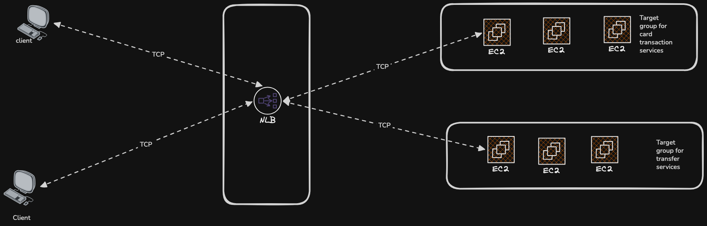

# Network Load Balancer

1. This is a service that operates on the layer 4 of the OSI model(Transport Layer).
2. Layer 4 deals with protocols such as TCP(priortises reliability, data integrity over speed), UDP(UDP is used for streaming video online, UDP priortises speed than accuracy)
3. Can handle millions of requests per seconds
4. NLB has only one static IP per AZ. Elastic IPs can also be assigned to each AZs. If you system is deployed across multiple AZs that means they can be access via mulitple Ips

## TCP Traffic Example

## Target Groupds For NLBS

1. EC2
2. IP addresses
3. Other application Load Balancers