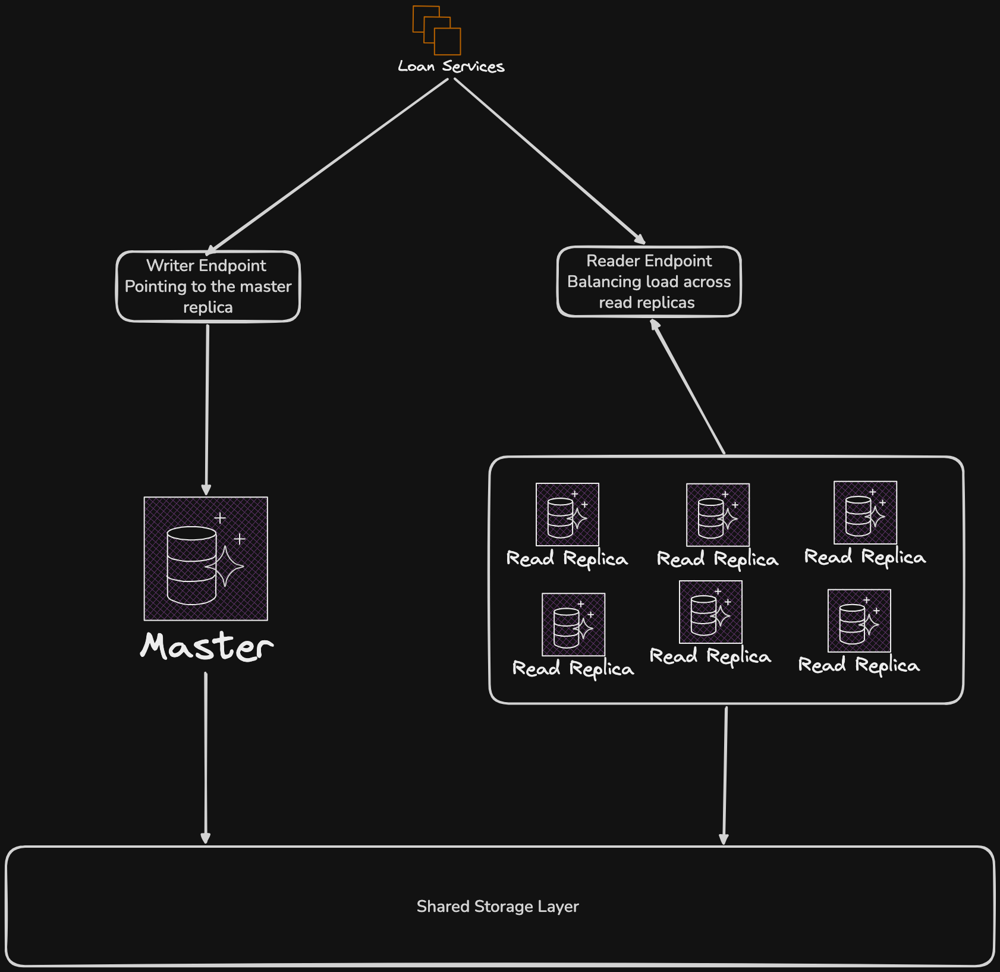
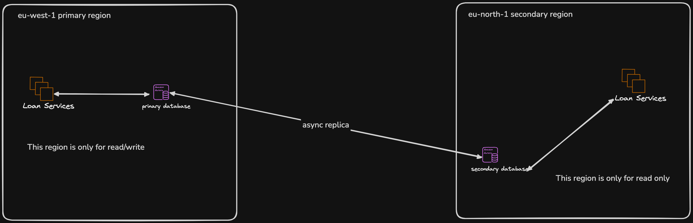

# Aurora

Aurora is a severless database services for OLTP workloads

## Aurora Birds Eye Architecture

1. For the read replica in aurora, you can setup replica autoscaling that adds new replica.
2. You can define custom endpoints for your read replica. Somewhat related to the reader endpoint

## Regular Aurora vs Aurora Global Database

- A regular Aurora database is one cluster that comprises of one shared storage volume in one region, with a writer and up to 15 readers attached.

- A Global Database is several clusters linked together, one per region. The primary cluster takes the writes, and each secondary cluster is a complete cluster in its own right with its own storage volume and instances. With Global database you 1 primary region(Read / Write) and up to 10 Secondary region for readonly, you can also create 16 read replicas per secondary regiion

- Typical cross region replication takes less than 1 second

## Reference

1. [https://homepages.cwi.nl/~boncz/lsde/papers/aurora.pdf]
