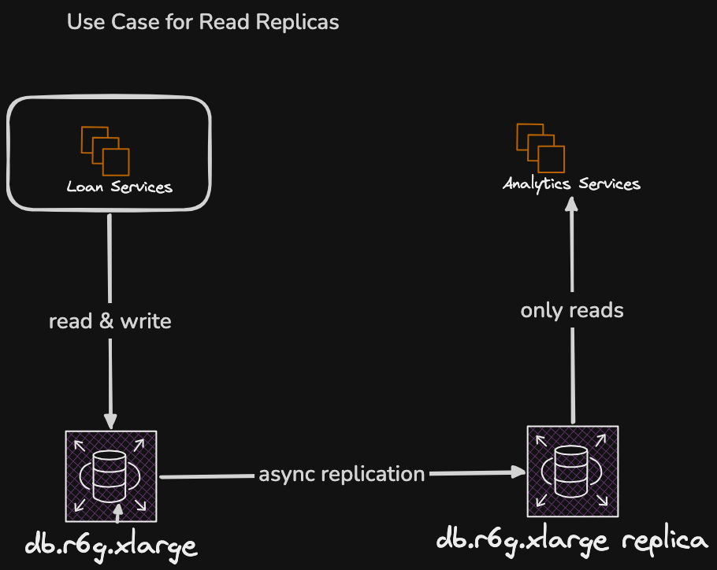
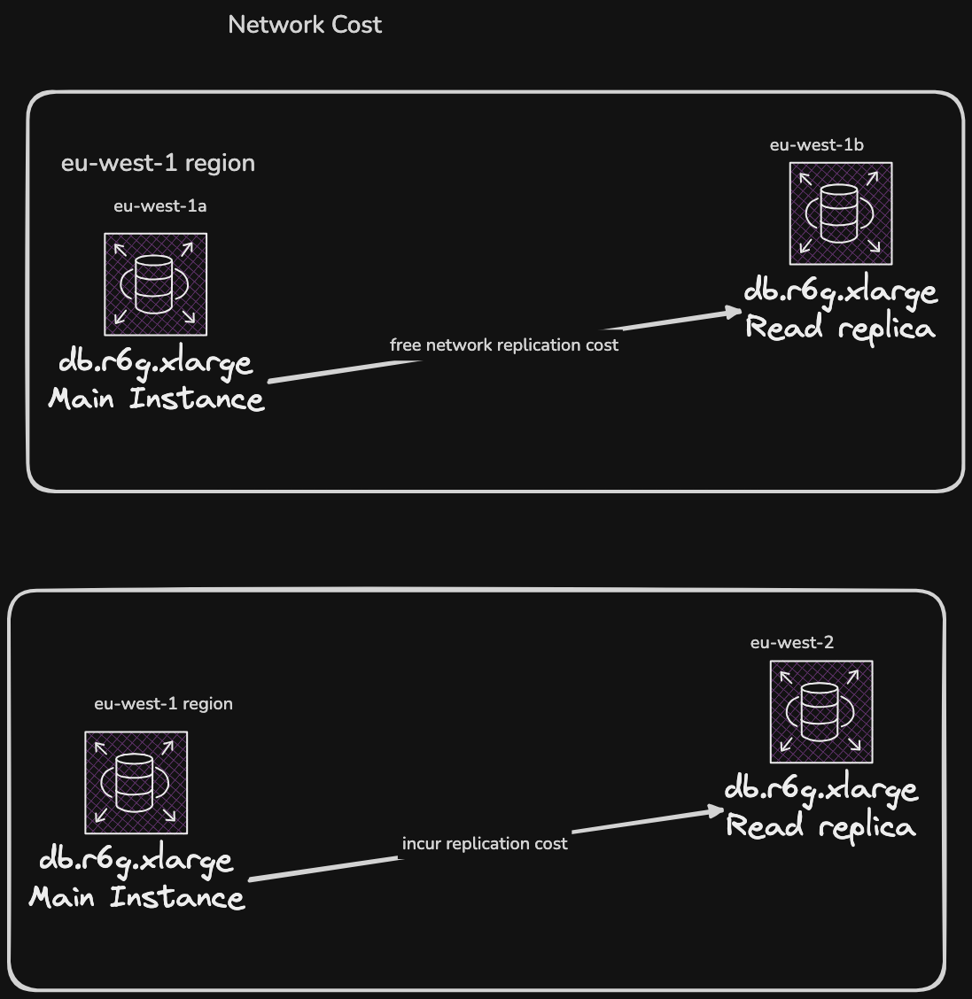
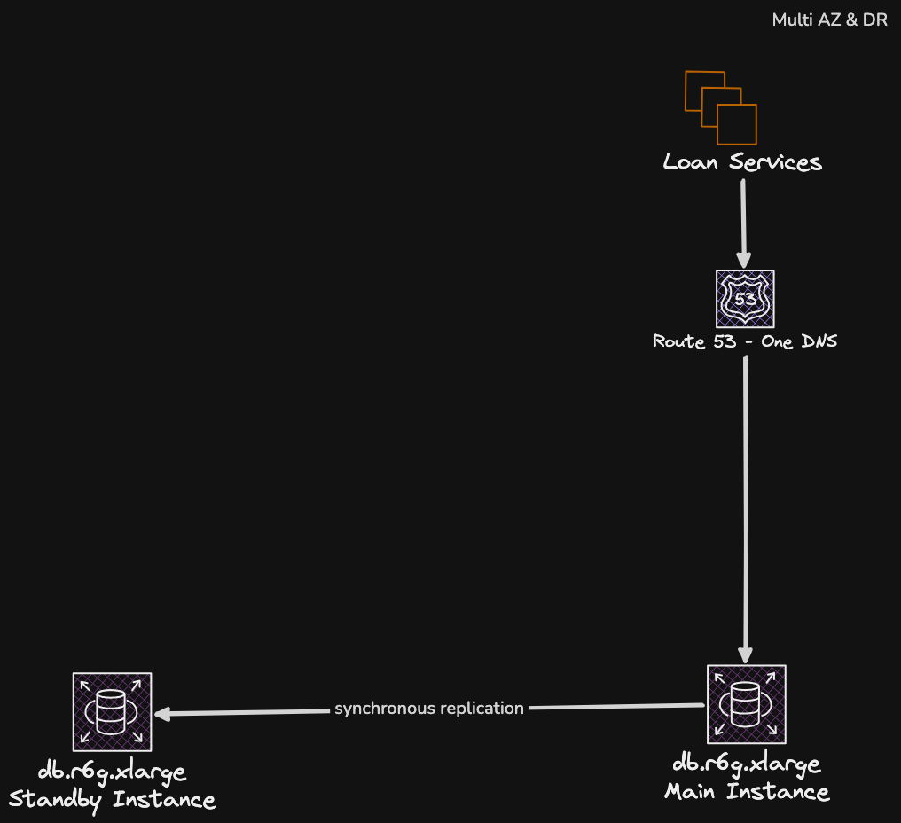
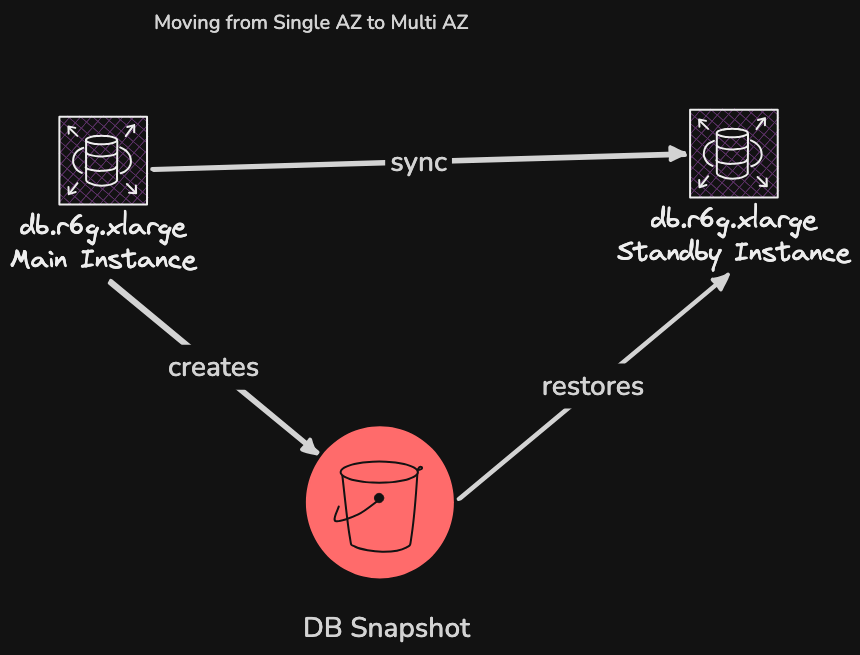

# RDS

RDS supports postgre, mysql, mariadb, oracle, sql server, IBM DB2 and aurora.

## DREC Organisation

fantasy company for this section is DREC a multinational fintech organization. DREC operations across 2 different regions, namely eu-west-1(IRELAND) eu-west-2(LONDON). DREC has two main features - Credit Score Tracking and Loans.

1. DREC DATABASE ISSUE

a. Problem - Bulk updates on the primary slow down reads. Read and Write contest for resources.

Our primary database is a db.r6g.xlarge. As a rough example, 1k reads/sec + 1k writes/sec
uses about 45% CPU (reads ≈ 35% per 1k, writes ≈ 10% per 1k).
We want to stay under 70% to keep a buffer.

At peak, our services send 2k reads/sec (≈70% CPU) and 2k writes/sec (≈20% CPU).
That's about 90% CPU, well over our 70% limit.

b. Solution

So we added 2 read replicas and moved most reads to them:

- The primary keeps writes + ~200 reads/sec that need the latest data → 20% + 7% ≈ 27% CPU
- Each replica takes ~900 reads/sec (≈32%) plus ~20% for replaying writes → ~52% CPU

## Why should I use RDS when I have EC2

1. Read Replica for performance
2. Automactic Scalibility Capability - In & Out
3. Automated Provision and OS Patching
4. Continous Backups and restore to specific timestamp
5. Monitoring Dashboards
6. Multi AZ setup for DR activity
7. storage backedup by EBS

## Read Replicas & Multi AZ

**Read Replicas & Asynchronous Replications***

With AWS

1. we can have 15 replicas that can be used within AZ, cross AZ or cross region.

2. Replication Technique for DREC database is Asynchronous which means

    - loan microservice persites data to the main db, db tells microservices persist is done successfully. After a few miliseconds primary database then sends data to the replication but it doesn't wait for replication to tell it if has recieved the data or not. Async replication is the standard choice for **cross-Region disaster recovery**, since sync replication is too slow over long distances. It can also improve day-to-day performance by offloading reads and analytics from the primary.
    - Pair it with cross-Region backups (snapshots / AWS Backup), because replication copies deletes and corruption too
    - Expect some data loss on failover (RPO = replication lag)
    - Only helps read performance; writes still go to the primary
3. Microservices must update connection string to connect with read replicas

### Use case

### Replication Cost

### MultiAZ and DR

Standby Instance becomes main instance in DR. But why does Multi AZ use synchronous replication? Multi-AZ = sync because it’s about availability without data loss. Read replicas = async because they’re about performance and distance.

### How to move from a single AZ to a multi AZ

### RDS Backups Trick

RDS has automated backup process that does daily backup of transactions logs every 5 minutes, this process allows point in time restore but this can be very expensive. The backup is for 1 - 35days

Another way is doing manual db snapshot with no expiry date

Trick - You can use snapshot to restore your RDS database

### RDS Security

1. Data Encryption is done at rest using KMS
2. To Encrypt an existing database, you can use snapshot and restore process
3. Read replica cannot be encrypted if the main database is not encrypted
4. IAM authentication with RDS
5. Control Network Access with SG
6. CloudWatch for audit logs

### RDS Proxy 

RDS proxy is a database proxy( A reverse proxy that sit between the client/application code and database servers). The proxy manage connection pooling, traffic, HA/failover etc.

RDS proxy improves database efficiency to reduce stress on the database resources such CPU and RAM and also minimizes open connections and timeoutes.

RDS proxy are never available publicly. They must be accessed from a VPC.

#### Reduces Failover by 66% Explained

The database fails over. The standby or reader becomes the new writer, taking about the same time with or without the proxy. Anything already committed is safe on the new writer.

2.Without the proxy, the app is slow to notice. Its connections break, it keeps hitting the old IP from cached DNS, and then every instance reconnects at once. This is where most of the downtime comes from.
    i. New requests sent during failover fail with connection errors or time out.
    ii. In-flight transactions are rolled back.

3.With the proxy, the app doesn't have to notice. The app stays connected to the proxy. The proxy spots the new writer straight away, holds requests for a moment, then sends them through on connections it already has open.

    i. New requests sent during failover are held, not failed. The app just sees a slower response.
    ii. In-flight transactions on the old writer still fail.

Example:

1. Without proxy: the app is broken for 60 s

    ~25 s for the database to fail over
    ~35 s more for the app to notice: dead connections timing out, cached DNS pointing at the old IP, then the reconnect storm
2. With proxy: the app is broken for 20 s

    The same ~25 s database failover, but the proxy starts routing to the new writer as soon as it's ready, and requests are held rather than failing, so the app sees less of it

reduction = (time without proxy − time with proxy) ÷ time without proxy
(60 − 20) ÷ 60 = 0.66 → 66% less downtime

## Reference

1. [https://www.youtube.com/watch?v=mBUCF1WGI_I]
2. [https://aws.amazon.com/what-is/data-replication/]
3. [https://aws.amazon.com/blogs/database/amazon-rds-under-the-hood-multi-az/]
4. [https://homepages.cwi.nl/~boncz/lsde/papers/aurora.pdf]
5. [https://aws.plainenglish.io/understanding-database-proxies-the-role-of-amazon-rds-proxy-55a7b1209ac8]