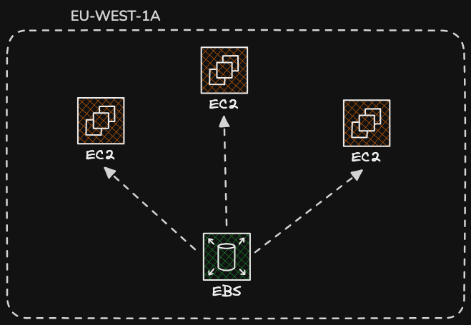

# Storage Notes

## EBS Elastic Block Store

So think of this like a network flash drive that is attached to your instance while they run. Its a portable storage device that is connected over the network. They are used to persist data even after their termination. Very good for long term storage

They are bound/locked to a specific AZ and they are easily detachable. Root/ primary EBS are deleted by default whenever the associated instance are terminated but secondary are not deleted by default.

The whole purpose of EBS volumes is persist data even after the termination of Instances..

 

EBS volume types - EBS volume types differ in performance, characterstics and cost

1. GP2 and GP3 SSD  - Transactional Workfloads, Low Latency applications
2. Io2 Block express - More IOPS performance aroudn 64k and High throughput
3. Io1 - IOPS performance around 16k, I/O intensive database workloads

### EBS Multi Attach

1. This is the process of attaching a single volume to multple instances in the same AZ.
2. A single EBS volume can only be attached to up to 16 instances at a time.
3. Multi Attach only works for the Io1 and Io2 families

## EC2 Instance Store (AKA High Performance Hardware Volumen for EC2s)

 1. Instance Store are disks(hard drives that are physicall bolted into a machine) physically attached to the host vms / computer.
 2. Instance store are ideal for temporary storage such as buffers, caches etc.
 3. Very good for temporary storage and I/O performance.
 4. Instance Store are ephemeral(Zero Durability)
