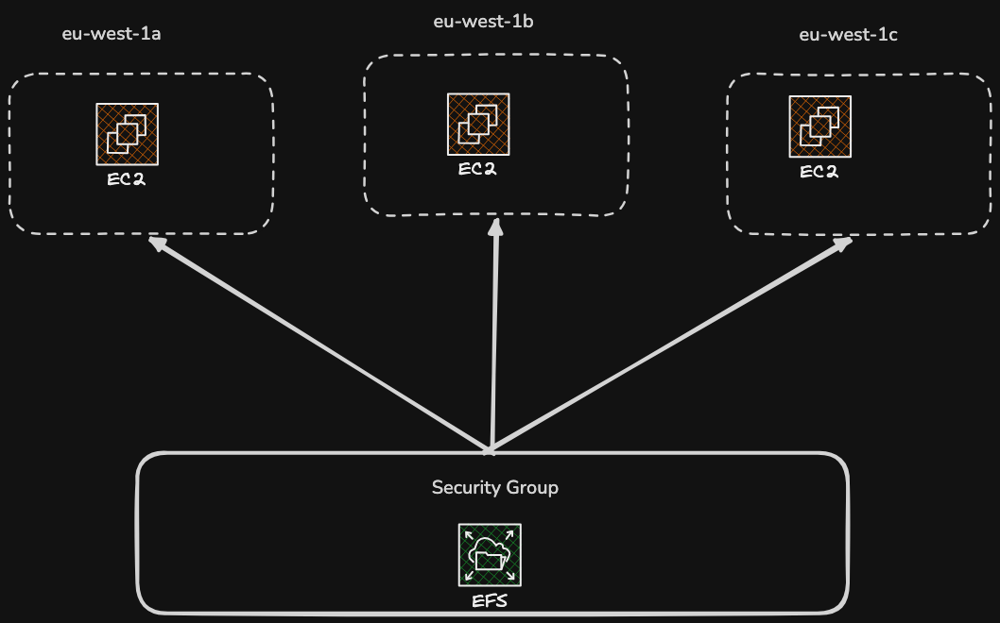

# File System

## EFS Elastic File System

1. Network File system that can be mounted on many EC2 instances(over 100s) across multiple AZ
2. Need Security Group to control the access for EFS
3. Used when multiple servers need to read and write the exact same files at the same time. While an EC2 instance can store files locally (on its root drive or an attached EBS volume), that storage is bound to a single machine. EFS acts as a shared network drive (using NFS) that solves several critical limitations
4. This service solves a lot of availability and durability problem(Standard Storage Class)

