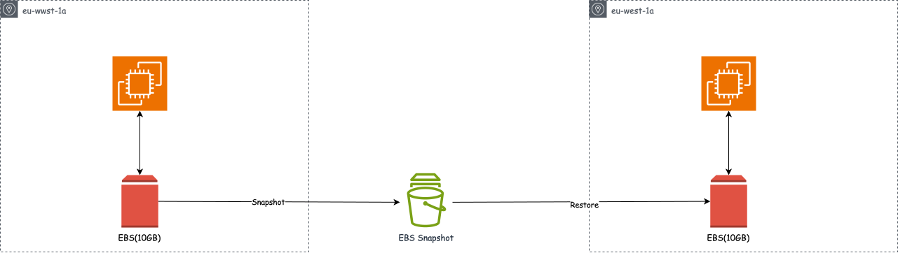

# Storage Resiliency

## EBS Snapshot(Backup)

1. Snapshots are point-in-time copies that serves as backed up data. Snapshot are incremental backups which means only blocks on the volume that have changed since the most recent snapshot, This is to prevent data duplication.

2. Snapshots can be copied across region and azs. Very very useful in DR, copy data to another region.

3. You can create EBS volumes from snapshots

 